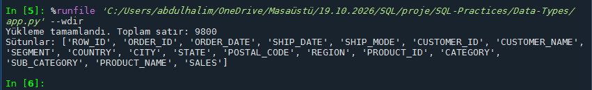
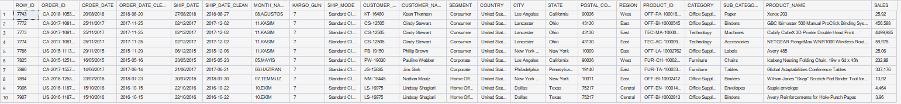
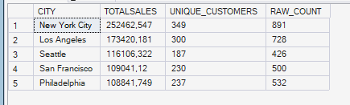
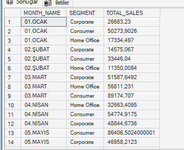
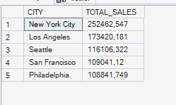

# 🚀 SQL Practices & Database Management

  <a href="#english">English</a> | <a href="#türkçe">Türkçe</a>

---

## 🇬🇧 English

This repository contains structured SQL exercises, data manipulation practices, and relational database management projects built with Microsoft SQL Server (SSMS) using T-SQL, focused on developing robust backend data skills.

### 📂 Repository Structure

- **`Day-04-Basic-Commands/`**: Fundamental DML operations including database creation (`CREATE DATABASE`, `USE`), table design with `IDENTITY` primary keys, `INSERT`, `UPDATE`, `DELETE`, and `TRUNCATE` operations, alongside conditional filtering (`WHERE`, `BETWEEN`, `LIKE`, `IN`, `AND`, `OR`), distinct records (`DISTINCT`), and sorting (`ORDER BY`, `TOP / PERCENT`).
- **`Data-Types/`**: Superstore Sales & Operations Analysis project using the Kaggle Sales Forecasting dataset (`train.csv`, 9,800 rows) ingested into SQL Server (`ETRADE3.dbo.RAW_SUPERSTORE`) via Python (`pandas`, `SQLAlchemy`, `pyodbc`) with `app.py` and queried via `data-types.sql`, covering `CONVERT` date parsing, `DATEPART`, `DATEDIFF`, `GROUP BY`, `COUNT(DISTINCT ...)`, `TOP`, and `WHERE` vs. `HAVING` filtering.

### 📝 Project Solutions & Evaluation Guide

Below is the structured overview of the practical SQL tasks completed in this section, along with technical assessments:

#### Day-04-Basic-Commands

1. **Table Creation & Data Insertion (INSERT)**
  - **Status:** Excellent. Successfully created the `ETRADE2` database and `CUSTOMERS` table using proper data types. Adhered to the core rule by omitting the `ID` field during `INSERT` statements, allowing the `IDENTITY(1,1)` constraint to handle auto-incrementing safely. Date formats and string literals were structured correctly.

2. **Data Retrieval & Sorting (SELECT, TOP, ORDER BY)**
- **Status:** Fully Correct. Accurately implemented `SELECT *`, `TOP 100`, and `TOP 50 PERCENT` clauses combined with `ORDER BY` using both ascending (`ASC`) and descending (`DESC`) ordering parameters.

3. **Data Modification & Dynamic Calculations (UPDATE & DATEDIFF)**
- **Status:** Outstanding. Implemented automated data updates such as setting global country codes (`NATION = 'TR'`) and dynamically calculating customer ages using `DATEDIFF(YEAR, BIRTHDATE, GETDATE())`. Handled targeted updates using precise `WHERE` clauses for gender categorization (`'ERKEK'` and `'KADIN'`).

4. **Advanced Filtering & Conditional Logic (WHERE, OR, <>, NOT, BETWEEN, LIKE, IN)**
- **Status:** Flawless. Correctly applied multi-condition filters including `OR`, negation operators (`<>` and `NOT`), range selections (`BETWEEN`), pattern matching (`LIKE`), and list memberships (`IN`).
  - *Note on Collation:* Handled textual casing and character considerations (e.g., `'ISTANBUL'` vs `'İSTANBUL'`) correctly in query structures.

5. **Distinct Records & Positional Sorting (DISTINCT & ORDER BY Column Indexes)**
- **Status:** Professional Grade. Utilized `DISTINCT` for retrieving unique cities and combined district-city subsets. Demonstrated advanced T-SQL capability by applying positional column sorting (`ORDER BY 3, 4, 2`) based on the `SELECT` projection sequence.

6. **Data Deletion & Table Reset (DELETE & TRUNCATE)**
- **Status:** Correct. Executed conditional row removal via `DELETE FROM CUSTOMERS WHERE ID = 1` and properly documented table-level truncation principles (`TRUNCATE TABLE CUSTOMERS`).

#### Data-Types — Superstore Sales & Operations Analysis

- **Dataset & Ingestion (`app.py`):** Loaded `train.csv` (9,800 rows) from the Kaggle Sales Forecasting dataset, normalized column names to uppercase snake_case, and transferred data into `ETRADE3.dbo.RAW_SUPERSTORE` (`localhost\SQLEXPRESS`) using `pandas` and `SQLAlchemy` (`fast_executemany=True`). SQL queries are maintained in [`data-types.sql`](./data-types.sql).

  

1. **Dataset Overview & Aggregations (Question 1)**
  - **Status:** Complete. Retrieved total row count along with minimum, maximum, average, and total `SALES` values in a single query.

2. **Date Conversion & Standardization (Question 2)**
- **Status:** Complete. Parsed string-formatted `ORDER_DATE` and `SHIP_DATE` values into `DATE` using `CONVERT(DATE, ..., 103)` and updated `ORDER_DATE_CLEAN` and `SHIP_DATE_CLEAN`.

3. **Month Extraction & Labeling (Question 3)**
- **Status:** Complete. Used `DATEPART(MONTH, ORDER_DATE_CLEAN)` to populate `MONTH_NAME` with ordered labels (`01.OCAK` through `12.ARALIK`) for clean chronological sorting.

4. **Shipping Duration Calculation (Question 4)**
- **Status:** Complete. Calculated `KARGO_GUN` via `DATEDIFF(DAY, ORDER_DATE_CLEAN, SHIP_DATE_CLEAN)` and retrieved the top 10 longest shipping records (`ORDER BY KARGO_GUN DESC`).

  

5. **Top Cities by Revenue (Question 5)**
- **Status:** Complete. Listed the top 5 cities by `SUM(SALES)` alongside `COUNT(DISTINCT CUSTOMER_ID)` and total row count (`COUNT(*)`), led by New York City (`252,462.547`, 349 unique customers, 891 rows) and Los Angeles (`173,420.181`, 300 unique customers, 728 rows).

  

6. **January City Breakdown (Question 6)**
- **Status:** Complete. Filtered `MONTH_NAME = '01.OCAK'` and grouped by `CITY` to report unique orders (`COUNT(DISTINCT ORDER_ID)`), unique customers (`COUNT(DISTINCT CUSTOMER_ID)`), and row counts (`COUNT(*)`).

7. **Category & Sub-Category Performance (Question 7)**
- **Status:** Complete. Aggregated `SUM(SALES)`, `AVG(SALES)`, and `COUNT(*)` by `CATEGORY` and `SUB_CATEGORY`, ordered by `CATEGORY ASC` and `SUM(SALES) DESC`.

8. **Monthly Segment Trend (Question 8)**
- **Status:** Complete. Grouped by `MONTH_NAME` and `SEGMENT` (`Consumer`, `Corporate`, `Home Office`) to calculate `SUM(SALES)` ordered by month label.

  

9. **Row-Level Filtering with WHERE (Question 9)**
- **Status:** Complete. Applied `WHERE SALES > 1000` prior to aggregation to compute city-level sales totals for high-value line items.

10. **Post-Aggregation Filtering with HAVING (Question 10)**
- **Status:** Complete. Grouped by `CITY` and applied `HAVING SUM(SALES) > 100000 AND COUNT(DISTINCT CUSTOMER_ID) > 10`, sorting by total sales descending (returning the top 5 cities above the 100k revenue threshold).

  

### 🛠 Tech Stack & Tools

- **Database Management System:** Microsoft SQL Server (MS SQL)
- **Environment:** SQL Server Management Studio (SSMS)
- **Query Language:** T-SQL (Transact-SQL)
- **Data Ingestion:** Python (`pandas`, `SQLAlchemy`, `pyodbc`)
- **Version Control:** Git, GitHub

---

## 🇹🇷 Türkçe

Bu repo, T-SQL kullanılarak Microsoft SQL Server (SSMS) üzerinde geliştirilmiş yapılandırılmış SQL egzersizleri, veri manipülasyon pratikleri ve ilişkisel veritabanı yönetim projeleri içermekte olup, sağlam backend veri becerileri geliştirmeyi amaçlamaktadır.

### 📂 Depo Yapısı

- **`Day-04-Basic-Commands/`**: Veritabanı oluşturma (`CREATE DATABASE`, `USE`), `IDENTITY` birincil anahtarları ile tablo tasarımı, `INSERT`, `UPDATE`, `DELETE` ve `TRUNCATE` işlemlerini içeren temel DML operasyonları; koşullu filtreleme (`WHERE`, `BETWEEN`, `LIKE`, `IN`, `AND`, `OR`), tekilleştirme (`DISTINCT`) ve sıralama (`ORDER BY`, `TOP / PERCENT`) çalışmaları.
- **`Data-Types/`**: Kaggle Sales Forecasting veri seti (`train.csv`, 9.800 satır) kullanılarak hazırlanan Superstore Satış ve Operasyon Analizi projesi; `app.py` (`pandas`, `SQLAlchemy`, `pyodbc`) ile verilerin SQL Server'a (`ETRADE3.dbo.RAW_SUPERSTORE`) aktarılması, `data-types.sql` sorgu dosyası ve `CONVERT`, `DATEPART`, `DATEDIFF`, `GROUP BY`, `COUNT(DISTINCT ...)`, `TOP` ile `WHERE` / `HAVING` sorgularını kapsar.

### 📝 Proje Çözümleri ve Değerlendirme Rehberi

Bu bölümde tamamlanan pratik SQL görevlerinin yapılandırılmış özeti ve teknik değerlendirmeleri aşağıdadır:

#### Day-04-Basic-Commands

1. **Tablo Oluşturma ve Veri Ekleme (INSERT)**
  - **Durum:** Mükemmel. `ETRADE2` veritabanı ve uygun veri tipleriyle `CUSTOMERS` tablosu kuruldu. `INSERT` işlemlerinde `ID` alanı dışarıda bırakılarak `IDENTITY(1,1)` kuralına tam uyum sağlandı. Tarih formatları ve metinsel ifadeler hatasız işlendi.

2. **Veri Listeleme ve Sıralama (SELECT, TOP, ORDER BY)**
- **Durum:** Tamamen Doğru. `SELECT *`, `TOP 100` ve `TOP 50 PERCENT` ifadeleri; `ORDER BY` ile artan (`ASC`) ve azalan (`DESC`) yönlü sıralamalarla kusursuz şekilde uygulandı.

3. **Veri Güncelleme ve Dinamik Hesaplama (UPDATE & DATEDIFF)**
- **Durum:** Harika. Tüm müşteriler için ülke bilgisi güncellenirken, `DATEDIFF(YEAR, BIRTHDATE, GETDATE())` fonksiyonu kullanılarak yaşların veritabanından dinamik olarak hesaplatılıp güncellenmesi sağlandı. Cinsiyet kısaltmaları `WHERE` koşullarıyla doğru kategorilere (`'ERKEK'`, `'KADIN'`) aktarıldı.

4. **Gelişmiş Filtreleme ve Koşullar (WHERE, OR, <>, NOT, BETWEEN, LIKE, IN)**
- **Durum:** Kusursuz. `OR`, olumsuzluk operatörleri (`<>` ve `NOT`), aralık seçimleri (`BETWEEN`), desen arama (`LIKE`) ve liste üyelikleri (`IN`) mantıksal olarak doğru uygulandı.
  - *Dil/Karakter Notu:* Sorgu yazımında metin eşleşme mantığı tam oturtuldu.

5. **Tekilleştirme ve Sıralama Analizleri (DISTINCT & Sıra Numaralarıyla ORDER BY)**
- **Durum:** Profesyonel Düzeyde. Benzersiz şehir ve ilçe kombinasyonları için `DISTINCT` başarıyla kullanıldı. `SELECT` içindeki sütun sıra numaralarına göre sıralama yapma (`ORDER BY 3, 4, 2`) gibi ileri düzey bir pratik başarıyla sergilendi.

6. **Veri Silme ve Tablo Sıfırlama (DELETE & TRUNCATE)**
- **Durum:** Doğru. `DELETE FROM CUSTOMERS WHERE ID = 1` ile koşullu satır silme işlemi yapıldı ve tablonun tamamını sıfırlamak için `TRUNCATE TABLE CUSTOMERS` mantığı dokümante edildi.

#### Data-Types — Superstore Satış ve Operasyon Analizi

- **Veri Seti ve Aktarım (`app.py` & `data-types.sql`):** Kaggle Sales Forecasting veri setindeki `train.csv` (9.800 satır) dosyası okundu, sütun adları büyük harf ve alt çizgi formatına çevrildi ve `pandas` + `SQLAlchemy` (`fast_executemany=True`) ile `ETRADE3.dbo.RAW_SUPERSTORE` (`localhost\SQLEXPRESS`) tablosuna aktarıldı. Tüm analitik T-SQL sorguları [`data-types.sql`](./data-types.sql) dosyasında yer alır.

  

1. **Veri Seti Özeti ve Toplulaştırma (Soru 1)**
  - **Durum:** Tamamlandı. Toplam satır sayısı ile `SALES` sütunu için en düşük, en yüksek, ortalama ve toplam satış tutarları tek sorguda getirildi.

2. **Tarih Dönüşümü ve Standartlaştırma (Soru 2)**
- **Durum:** Tamamlandı. Metin tipindeki `ORDER_DATE` ve `SHIP_DATE` değerleri `CONVERT(DATE, ..., 103)` ile `DATE` tipine çevrilerek `ORDER_DATE_CLEAN` ve `SHIP_DATE_CLEAN` sütunlarına işlendi.

3. **Ay Çıkarımı ve Etiketleme (Soru 3)**
- **Durum:** Tamamlandı. `DATEPART(MONTH, ORDER_DATE_CLEAN)` kullanılarak `MONTH_NAME` sütunu `01.OCAK` – `12.ARALIK` formatında güncellendi ve sıralı ay gösterimi sağlandı.

4. **Kargo Süresi Hesaplama (Soru 4)**
- **Durum:** Tamamlandı. `DATEDIFF(DAY, ORDER_DATE_CLEAN, SHIP_DATE_CLEAN)` ile `KARGO_GUN` hesaplandı ve en uzun kargo süresine sahip ilk 10 kayıt (`ORDER BY KARGO_GUN DESC`) listelendi.

  

5. **Ciroya Göre İlk 5 Şehir (Soru 5)**
- **Durum:** Tamamlandı. `SUM(SALES)` bazında ilk 5 şehir; tekil müşteri (`COUNT(DISTINCT CUSTOMER_ID)`) ve satır sayısı (`COUNT(*)`) ile listelendi (örneğin New York City: `252462,547` ciro, `349` tekil müşteri, `891` satır).

  

6. **Ocak Ayı Şehir Kırılımı (Soru 6)**
- **Durum:** Tamamlandı. `MONTH_NAME = '01.OCAK'` filtresiyle şehirlere göre tekil sipariş (`COUNT(DISTINCT ORDER_ID)`), tekil müşteri (`COUNT(DISTINCT CUSTOMER_ID)`) ve satır sayıları (`COUNT(*)`) getirildi.

7. **Kategori ve Alt Kategori Analizi (Soru 7)**
- **Durum:** Tamamlandı. `CATEGORY` ve `SUB_CATEGORY` kırılımında toplam ciro (`SUM(SALES)`), ortalama satış (`AVG(SALES)`) ve kayıt sayısı (`COUNT(*)`) hesaplanıp `CATEGORY ASC, SUM(SALES) DESC` ile sıralandı.

8. **Aylık Segment Trendi (Soru 8)**
- **Durum:** Tamamlandı. `MONTH_NAME` ve `SEGMENT` (`Consumer`, `Corporate`, `Home Office`) kırılımında toplam satışlar hesaplanıp ay adına göre sıralandı.

  

9. **WHERE ile Satır Bazlı Filtreleme (Soru 9)**
- **Durum:** Tamamlandı. Gruplama öncesinde `WHERE SALES > 1000` uygulanarak yüksek tutarlı satırların şehirlere göre toplam satışları listelendi.

10. **HAVING ile Gruplama Sonrası Filtreleme (Soru 10)**
- **Durum:** Tamamlandı. Şehirlere göre gruplama sonrası `HAVING SUM(SALES) > 100000 AND COUNT(DISTINCT CUSTOMER_ID) > 10` koşulu uygulanıp ciroya göre azalan sıralandı (100 bin barajını aşan ilk 5 şehir listelendi).

  

### 🛠 Teknoloji Yığını ve Araçlar

- **Veritabanı Yönetim Sistemi:** Microsoft SQL Server (MS SQL)
- **Ortam:** SQL Server Management Studio (SSMS)
- **Sorgu Dili:** T-SQL (Transact-SQL)
- **Veri Aktarımı:** Python (`pandas`, `SQLAlchemy`, `pyodbc`)
- **Versiyon Kontrolü:** Git, GitHub
