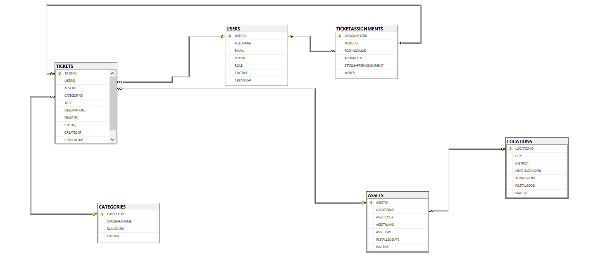

# 🛠️ FieldServiceDB — Field Service Management Database

  <a href="#english">English</a> | <a href="#türkçe">Türkçe</a>

---

## 🇬🇧 English

A relational database design and sample dataset for a **Field Service Management** system built with **Microsoft SQL Server (SSMS)** using **T-SQL**, focused on structuring users, locations, field assets, categories, tickets, and technician assignments with strong data integrity.

### 📂 Schema & Data Overview

- **`FieldServiceDB` Schema & Constraints**: Creates six interconnected tables (`USERS`, `LOCATIONS`, `ASSETS`, `CATEGORIES`, `TICKETS`, `TICKETASSIGNMENTS`) using `IDENTITY(1,1)` primary keys, `FOREIGN KEY` relationships, `UNIQUE` rules, `DEFAULT` values, and `CHECK` constraints for roles, priorities, statuses, and SLA hours.
- **Sample Data (`INSERT`)**: Populates reference and operational records in dependency order (`USERS`, `LOCATIONS`, `CATEGORIES`, followed by `ASSETS`, `TICKETS`, and `TICKETASSIGNMENTS`) so relationships and status flows can be tested immediately in SSMS.
- **Database Diagram (`ERD`)**: Visualizes all six tables and their `1-N` foreign key connections in SSMS.

  

### 📝 Project Structure & Technical Highlights

1. **Users & Roles (`USERS`)**
   - **Status:** Complete. Tracks customers, operators, and technicians with unique email enforcement, active status flag, and creation timestamp.

2. **Locations & Field Assets (`LOCATIONS` & `ASSETS`)**
   - **Status:** Complete. Links physical service addresses to tracked equipment with unique asset codes and installation dates.

3. **Categories & SLA Targets (`CATEGORIES`)**
   - **Status:** Complete. Defines unique service categories with positive SLA hour thresholds (`SLAHOURS > 0`).

4. **Tickets & Assignments (`TICKETS` & `TICKETASSIGNMENTS`)**
   - **Status:** Complete. Connects tickets to users, assets, and categories with priority/status checks and resolution timestamps, while logging technician assignments, timestamps, status updates, and notes.

### 🛠 Tech Stack & Tools

- **Database Management System:** Microsoft SQL Server (MS SQL)
- **Environment:** SQL Server Management Studio (SSMS)
- **Query Language:** T-SQL
- **Version Control:** Git, GitHub

---

## 🇹🇷 Türkçe

Bu çalışma, **Microsoft SQL Server (SSMS)** üzerinde **T-SQL** kullanılarak geliştirilmiş **Saha Servis Yönetimi (`FieldServiceDB`)** ilişkisel veritabanı tasarımını ve örnek veri kurgusunu kapsar; kullanıcılar, lokasyonlar, saha varlıkları/cihazları, kategoriler, talepler ve teknisyen atamaları arasında veri bütünlüğü sağlar.

### 📂 Şema ve Veri Özeti

- **`FieldServiceDB` Şeması ve Kısıtları**: `USERS`, `LOCATIONS`, `ASSETS`, `CATEGORIES`, `TICKETS` ve `TICKETASSIGNMENTS` olmak üzere altı tabloyu `IDENTITY(1,1)` birincil anahtarlar, `FOREIGN KEY` ilişkileri, `UNIQUE` kuralları, `DEFAULT` değerleri ve rol/öncelik/durum/SLA `CHECK` kısıtlarıyla oluşturur.
- **Örnek Veri Kurgusu (`INSERT`)**: İlişki bağımlılık sırasına uygun şekilde (`USERS`, `LOCATIONS`, `CATEGORIES` ve ardından `ASSETS`, `TICKETS`, `TICKETASSIGNMENTS`) test kayıtları ekleyerek şemanın SSMS'te doğrudan denenmesini sağlar.
- **Veritabanı Diyagramı (`ERD`)**: Altı tablonun tamamını ve aralarındaki `1-N` yabancı anahtar bağlantılarını görsel olarak sunar.

  

### 📝 Proje Yapısı ve Teknik Özet

1. **Kullanıcılar ve Roller (`USERS`)**
   - **Durum:** Tamamlandı. Müşteri, operatör ve teknisyen kayıtlarını benzersiz e-posta kuralı, aktiflik bilgisi ve oluşturulma zamanıyla tutar.

2. **Lokasyonlar ve Saha Varlıkları (`LOCATIONS` & `ASSETS`)**
   - **Durum:** Tamamlandı. Fiziksel adres kayıtlarını benzersiz varlık koduna ve kurulum tarihine sahip cihazlarla ilişkilendirir.

3. **Kategoriler ve SLA Hedefleri (`CATEGORIES`)**
   - **Durum:** Tamamlandı. Benzersiz servis kategorilerini pozitif SLA saat değerleriyle (`SLAHOURS > 0`) tanımlar.

4. **Talepler ve Atamalar (`TICKETS` & `TICKETASSIGNMENTS`)**
   - **Durum:** Tamamlandı. Talepleri kullanıcı, varlık ve kategoriyle bağlayıp öncelik/durum kısıtları ve kapanış zamanıyla izler; teknisyen atamalarını, atama zamanlarını, durum geçişlerini ve notları kayıt altına alır.

### 🛠 Teknoloji Yığını ve Araçlar

- **Veritabanı Yönetim Sistemi:** Microsoft SQL Server (MS SQL)
- **Ortam:** SQL Server Management Studio (SSMS)
- **Sorgu Dili:** T-SQL
- **Versiyon Kontrolü:** Git, GitHub