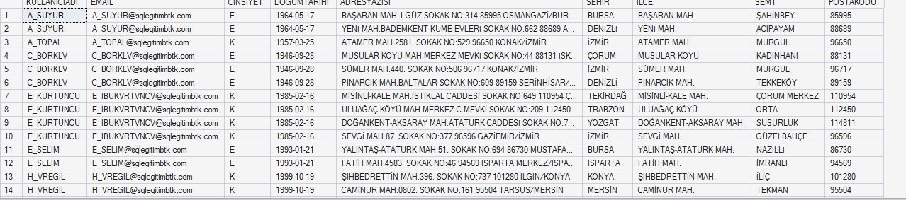
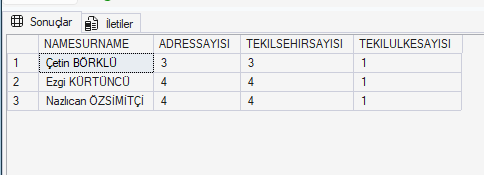
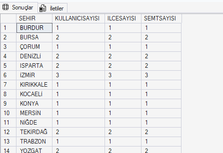

# 🔗 Joins-GroupBy — Relational Joins & Aggregations

  <a href="#english">English</a> | <a href="#türkçe">Türkçe</a>

---

## 🇬🇧 English

A relational SQL practice set built with **Microsoft SQL Server (SSMS)** using **T-SQL**, focused on querying across six interconnected location and user tables (`USERS`, `ADDRESS`, `COUNTRIES`, `CITIES`, `TOWNS`, `DISTRICTS`) through `WHERE` joins, explicit `INNER JOIN ... ON ...`, `DISTINCT`, `GROUP BY`, `HAVING`, and `INSERT` / `TRUNCATE` operations.

### 📂 Queries & Output Overview

* **Relational Query Script (`Joins-GroupBy.sql`)**: Covers eight progressive exercises ranging from single-table `SELECT` / `WHERE` filtering and legacy `WHERE`-clause multi-table joins to column/table aliases, `DISTINCT`, `COUNT(DISTINCT ...)`, `GROUP BY` with `HAVING`, explicit `INNER JOIN ... ON ...`, and `INSERT` / `TRUNCATE` statements.

* **Multi-Table Join Result (`question_3.png`)**: Displays joined user, contact, address, city (`SEHIR`), district (`ILCE`), sub-region (`SEMT`), and postal code (`POSTAKODU`) fields ordered by `U.USERNAME_`.

  

* **User-Level Aggregation & `HAVING` (`question_5.png`)**: Filters users having more than two addresses (`HAVING COUNT(A.ID) > 2`) alongside their total address, unique city, and unique country counts.

  

* **City-Level Aggregation (`question_6.png`)**: Summarizes user, district, and town counts grouped by `CT.CITY` (`SEHIR`).

  

### 📝 Exercises & Solutions

1. **Single-Table Selection & Filtering (`SELECT` & `WHERE`)**
   * **Status:** Complete. Retrieves the `USERS` record where `ID = 1` and the `ADDRESS` records where `USERID = 1` as separate queries.

2. **Two-Table Join with `WHERE` & Aliases**
   * **Status:** Complete. Joins `USERS` and `ADDRESS` on `U.ID = A.USERID` for `U.ID = 4`, applying column aliases (`KULLANICIADI`, `EMAIL`, `CINSIYET`, `DOGUMTARIHI`, `ADRESYAZISI`) both with and without `AS`.

3. **Six-Table Join with `WHERE` & Ordering**
   * **Status:** Complete. Connects `USERS`, `ADDRESS`, `COUNTRIES`, `CITIES`, `TOWNS`, and `DISTRICTS` using `WHERE` equality conditions and orders results by `U.USERNAME_`.

4. **Distinct Values & Unique User Count (`DISTINCT` & `COUNT(DISTINCT ...)`)**
   * **Status:** Complete. Extracts unique user values (`DISTINCT U.USERNAME_`) ordered by username and calculates the total unique user count (`COUNT(DISTINCT U.ID)`).

5. **Per-User Address, City & Country Counts (`GROUP BY` & `HAVING`)**
   * **Status:** Complete. Groups by `U.NAMESURNAME` to compute address (`COUNT(A.ID)`), unique city (`COUNT(DISTINCT CT.ID)`), and unique country (`COUNT(DISTINCT C.ID)`) counts for users with `COUNT(A.ID) > 2`.

6. **City-Level Aggregation (`GROUP BY`)**
   * **Status:** Complete. Groups records by `CT.CITY` (`SEHIR`) to summarize user (`COUNT(U.ID)`), district (`COUNT(D.ID)`), and town (`COUNT(T.ID)`) counts.

7. **Explicit `INNER JOIN ... ON ...` Syntax**
   * **Status:** Complete. Joins all six tables with explicit `INNER JOIN ... ON ...` clauses to list `U.USERNAME_`, `U.EMAIL`, `A.ADDRESSTEXT`, `C.COUNTRY`, `CT.CITY`, `T.TOWN`, and `D.DISTRICT`, followed by a `GROUP BY CT.CITY` query summarizing user counts per city.

8. **`INSERT` & `TRUNCATE` Operations**
   * **Status:** Complete. Adds a sample district record `(20, 'ACIPINAR-BAHÇELİEVLER MAH.')` into `DISTRICTS (TOWNID, DISTRICT)` and demonstrates `TRUNCATE TABLE` statements for `DISTRICTS`, `USERS`, and `ADDRESS`.

### 🛠 Tech Stack & Tools

* **Database Management System:** Microsoft SQL Server (MS SQL)
* **Environment:** SQL Server Management Studio (SSMS)
* **Query Language:** T-SQL
* **Version Control:** Git, GitHub

---

## 🇹🇷 Türkçe

Bu çalışma, **Microsoft SQL Server (SSMS)** üzerinde **T-SQL** kullanılarak geliştirilmiş ilişkisel SQL sorgu pratiklerini kapsar; altı bağlantılı kullanıcı ve konum tablosu (`USERS`, `ADDRESS`, `COUNTRIES`, `CITIES`, `TOWNS`, `DISTRICTS`) üzerinde `WHERE` ile birleştirme, açık `INNER JOIN ... ON ...`, `DISTINCT`, `GROUP BY`, `HAVING` ve `INSERT` / `TRUNCATE` işlemlerini uygular.

### 📂 Sorgular ve Çıktı Özeti

* **İlişkisel Sorgu Betiği (`Joins-GroupBy.sql`)**: Tek tablo `SELECT` / `WHERE` filtreleme ve klasik `WHERE` birleştirmelerinden başlayarak sütun/tablo takma adları (`ALIAS`), `DISTINCT`, `COUNT(DISTINCT ...)`, `GROUP BY` ile `HAVING`, açık `INNER JOIN ... ON ...` ve `INSERT` / `TRUNCATE` ifadelerine uzanan sekiz aşamalı alıştırmayı içerir.

* **Çoklu Tablo Birleştirme Çıktısı (`question_3.png`)**: `U.USERNAME_` ile sıralanmış kullanıcı, iletişim, adres, şehir (`SEHIR`), ilçe (`ILCE`), semt (`SEMT`) ve posta kodu (`POSTAKODU`) alanlarını gösterir.

  

* **Kullanıcı Bazlı Toplulaştırma ve `HAVING` (`question_5.png`)**: Adres sayısı ikiden fazla olan (`HAVING COUNT(A.ID) > 2`) kullanıcıları toplam adres, tekil şehir ve tekil ülke sayılarıyla listeler.

  

* **Şehir Bazlı Toplulaştırma (`question_6.png`)**: `CT.CITY` (`SEHIR`) kırılımında kullanıcı, ilçe ve semt sayılarını özetler.

  

### 📝 Sorular ve Çözümler

1. **Tek Tablo Seçme ve Filtreleme (`SELECT` & `WHERE`)**
   * **Durum:** Tamamlandı. `USERS` tablosundan `ID = 1` kaydını ve `ADDRESS` tablosundan `USERID = 1` adreslerini ayrı sorgularla getirir.

2. **İki Tabloyu `WHERE` ile Birleştirme ve Takma Adlar**
   * **Durum:** Tamamlandı. `USERS` ve `ADDRESS` tablolarını `U.ID = A.USERID` koşuluyla `U.ID = 4` için birleştirir; `AS` kullanarak ve kullanmadan sütun takma adları (`KULLANICIADI`, `EMAIL`, `CINSIYET`, `DOGUMTARIHI`, `ADRESYAZISI`) uygular.

3. **Altı Tabloyu `WHERE` ile Bağlama ve Sıralama**
   * **Durum:** Tamamlandı. `USERS`, `ADDRESS`, `COUNTRIES`, `CITIES`, `TOWNS` ve `DISTRICTS` tablolarını `WHERE` eşitlik koşullarıyla birleştirip sonuçları `U.USERNAME_` ile sıralar.

4. **Tekil Kayıt ve Tekil Kullanıcı Sayımı (`DISTINCT` & `COUNT(DISTINCT ...)`)**
   * **Durum:** Tamamlandı. Bağlı tablolardan tekil kullanıcıları (`DISTINCT U.USERNAME_`) kullanıcı adına göre sıralı listeler ve toplam tekil kullanıcı sayısını (`COUNT(DISTINCT U.ID)`) hesaplar.

5. **Kullanıcı Bazlı Adres, Şehir ve Ülke Sayımı (`GROUP BY` & `HAVING`)**
   * **Durum:** Tamamlandı. `U.NAMESURNAME` kırılımında gruplayarak `COUNT(A.ID) > 2` koşulunu sağlayan kullanıcıların adres (`COUNT(A.ID)`), tekil şehir (`COUNT(DISTINCT CT.ID)`) ve tekil ülke (`COUNT(DISTINCT C.ID)`) sayılarını getirir.

6. **Şehir Bazlı Toplulaştırma (`GROUP BY`)**
   * **Durum:** Tamamlandı. Kayıtları `CT.CITY` (`SEHIR`) bazında gruplayarak kullanıcı (`COUNT(U.ID)`), ilçe (`COUNT(D.ID)`) ve semt (`COUNT(T.ID)`) sayılarını özetler.

7. **Açık `INNER JOIN ... ON ...` Sözdizimi**
   * **Durum:** Tamamlandı. Altı tabloluk birleştirmeyi açık `INNER JOIN ... ON ...` yapısıyla kurarak `U.USERNAME_`, `U.EMAIL`, `A.ADDRESSTEXT`, `C.COUNTRY`, `CT.CITY`, `T.TOWN` ve `D.DISTRICT` alanlarını listeler; ayrıca `GROUP BY CT.CITY` ile şehir bazında kullanıcı sayısını hesaplar.

8. **`INSERT` ve `TRUNCATE` Kullanımı**
   * **Durum:** Tamamlandı. `DISTRICTS (TOWNID, DISTRICT)` tablosuna `(20, 'ACIPINAR-BAHÇELİEVLER MAH.')` kaydını ekler ve `DISTRICTS`, `USERS`, `ADDRESS` tabloları için `TRUNCATE TABLE` ifadelerini içerir.

### 🛠 Teknoloji Yığını ve Araçlar

* **Veritabanı Yönetim Sistemi:** Microsoft SQL Server (MS SQL)
* **Ortam:** SQL Server Management Studio (SSMS)
* **Sorgu Dili:** T-SQL
* **Versiyon Kontrolü:** Git, GitHub