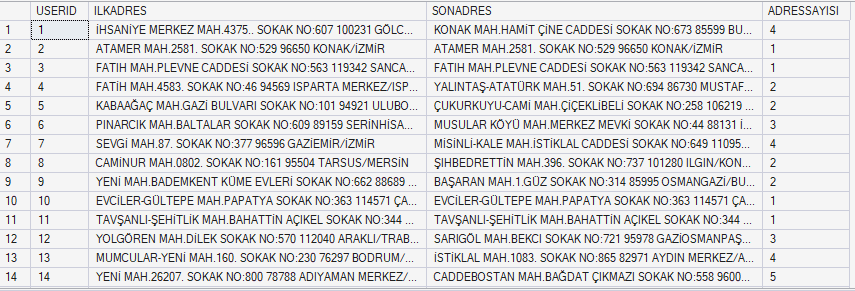
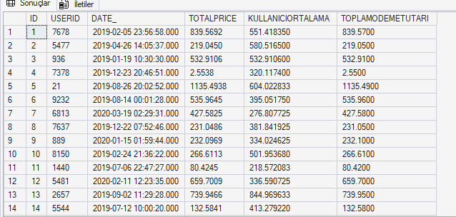
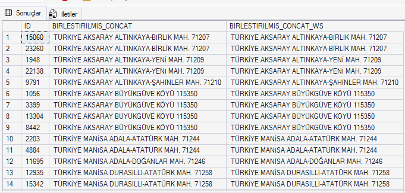
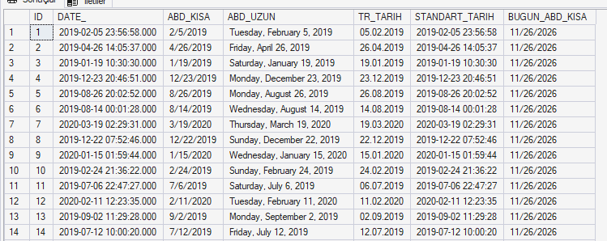

# 🔍 Subqueries-StringFunctions — Correlated Subqueries & String/Date Functions

  <a href="#english">English</a> | <a href="#türkçe">Türkçe</a>

---

## 🇬🇧 English

A **T-SQL** practice set built with **Microsoft SQL Server (SSMS)** covering aggregate grouping, correlated scalar subqueries, multi-table joins, string parsing/cleaning/formatting functions (`LEFT`, `RIGHT`, `CHARINDEX`, `SUBSTRING`, `TRIM`, `LTRIM`, `RTRIM`, `CONCAT`, `CONCAT_WS`, `REPLICATE`, `REPLACE`, `LOWER`, `UPPER`, `REVERSE`, `ASCII`, `CHAR`), and locale-aware date formatting (`FORMAT`, `CONVERT`). The schema and exercises are based on **BTK Akademi**'s **"Uygulamalarla SQL Öğreniyorum"** course, taught by **Ömer Faruk Çolakoğlu**. The dataset used in these exercises comes from **BTK Akademi**'s **"Uygulamalarla SQL Öğreniyorum"** course (instructor: **Ömer Faruk Çolakoğlu**).

### 📂 Queries & Output Overview

- **Query Script (`subqueries-string-functions.sql`)**: Contains 12 progressive exercises spanning brand-level aggregations, correlated subqueries across `ITEMS`, `ADDRESS`, `ORDERS`, and `PAYMENTS`, string splitting and whitespace trimming, zero-padded code generation in `TEST`, multi-locale date formatting, and character-level transformations.

- **User Address History via Correlated Subqueries (`question_3.png`)**: Displays each unique `USERID` alongside their first address (`ILKADRES`), last address (`SONADRES`), and total address count (`ADRESSAYISI`).

  

- **Order & Payment Summary (`question_4.png`)**: Combines per-user average order amount (`KULLANICIORTALAMA`) and per-order total payment (`TOPLAMODEMETUTARI`) using scalar subqueries.

  

- **Multi-Table Location Concatenation (`question_8.png`)**: Joins `ADDRESS`, `COUNTRIES`, `CITIES`, and `DISTRICTS` to compare `CONCAT` and `CONCAT_WS` outputs.

  

- **Multi-Locale Date Formatting (`question_10.png`)**: Formats `ORDERS.DATE_` and `GETDATE()` into US short/long dates, Turkish `dd.MM.yyyy`, and ISO-like `CONVERT(..., 120)` strings.

  

### 📝 Exercises & Solutions

1. **Brand-Level Price Summary (`GROUP BY` & Aggregates)**
  - **Status:** Complete. Groups `ITEMS` by `BRAND` (`MARKA`) to calculate `MIN`, `MAX`, `AVG` unit prices and item counts (`COUNT(*)`), ordered by `AVG(UNITPRICE) DESC`.

2. **Brand Average Price via Correlated Subquery**
- **Status:** Complete. Lists item codes, names, brands, and unit prices alongside each brand's average price (`MARKAORTALAMAFIYAT`) computed via a correlated subquery (`I.BRAND = I2.BRAND`).

3. **First, Last & Total Address per User (`TOP 1` & Correlated Subqueries)**
- **Status:** Complete. Queries distinct `USERID` values from `ADDRESS` to retrieve `ILKADRES` (`ORDER BY ID ASC`), `SONADRES` (`ORDER BY ID DESC`), and `ADRESSAYISI` (`COUNT`), ordered by `USERID ASC`.

4. **User Average Order & Order Total Payment (`ORDERS` & `PAYMENTS`)**
- **Status:** Complete. Retrieves each order's `ID`, `USERID`, `DATE_`, and `TOTALPRICE` along with the user's average order total (`KULLANICIORTALAMA`) and total paid amount (`TOPLAMODEMETUTARI`).

5. **Splitting Address Text on First Space (`LEFT`, `RIGHT`, `CHARINDEX`, `LEN`)**
- **Status:** Complete. Filters `ADDRESS` rows containing spaces (`CHARINDEX(' ', ADDRESSTEXT) > 0`) and splits `ADDRESSTEXT` into `ILKPARCA` and `KALANPARCA`.

6. **Last Character Filtering (`SUBSTRING` & `LEN`)**
- **Status:** Complete. Extracts the final character of `COUNTRIES.COUNTRY` via `SUBSTRING(COUNTRY, LEN(COUNTRY), 1)` and returns countries ending with `'A'`, ordered alphabetically.

7. **Whitespace Trimming & Length Comparison (`TRIM`, `LTRIM`, `RTRIM`, `LEN`)**
- **Status:** Complete. Compares original and trimmed lengths of `ITEMS.ITEMNAME` and filters rows where `LEN(ITEMNAME) <> LEN(TRIM(ITEMNAME))`.

8. **Concatenating Location Fields (`INNER JOIN`, `CONCAT` & `CONCAT_WS`)**
- **Status:** Complete. Joins `ADDRESS` with `COUNTRIES`, `CITIES`, and `DISTRICTS` to build combined location strings using both `CONCAT` and `CONCAT_WS`.

9. **Zero-Padded Serial Number Update (`REPLICATE` & `CONVERT`)**
- **Status:** Complete. Updates `TEST.SIRANO2` by left-padding `SIRANO` with leading zeros up to 8 characters using `REPLICATE('0', 8 - LEN(SIRANO)) + CONVERT(VARCHAR(10), SIRANO)`.

10. **Date Formatting Across Locales (`FORMAT`, `CONVERT` & `GETDATE`)**
- **Status:** Complete. Formats `ORDERS.DATE_` into `en-us` (`'d'`, `'D'`), `tr-TR` (`'dd.MM.yyyy'`), and ODBC canonical (`120`) formats alongside current date `FORMAT(GETDATE(), 'd', 'en-us')`.

11. **Substring Replacement & Occurrence Count (`REPLACE`, `LEN` & Variables)**
- **Status:** Complete. Declares a `VARCHAR(MAX)` text variable, replaces `'Pro'` with `'Max'` via `REPLACE`, and calculates occurrence frequency from length differences.

12. **Case Conversion, Reversal & Character Codes (`LOWER`, `UPPER`, `REVERSE`, `ASCII`, `CHAR`)**
- **Status:** Complete. Transforms `ITEMS.ITEMNAME` into lowercase, uppercase, and reversed text alongside `ASCII` and `CHAR` code evaluations.

### 🛠 Tech Stack & Tools

- **Database Management System:** Microsoft SQL Server (MS SQL)
- **Environment:** SQL Server Management Studio (SSMS)
- **Query Language:** T-SQL
- **Version Control:** Git, GitHub

---

## 🇹🇷 Türkçe

Bu çalışma, **Microsoft SQL Server (SSMS)** üzerinde **T-SQL** kullanılarak geliştirilmiş ilişkili alt sorgu (*correlated subquery*), metin parçalama/temizleme/biçimlendirme (`LEFT`, `RIGHT`, `CHARINDEX`, `SUBSTRING`, `TRIM`, `LTRIM`, `RTRIM`, `CONCAT`, `CONCAT_WS`, `REPLICATE`, `REPLACE`, `LOWER`, `UPPER`, `REVERSE`, `ASCII`, `CHAR`) ve tarih formatlama (`FORMAT`, `CONVERT`) pratiklerini içerir. Kullanılan veritabanı şeması ve alıştırmalar, **BTK Akademi** bünyesinde **Ömer Faruk Çolakoğlu** tarafından verilen **"Uygulamalarla SQL Öğreniyorum"** eğitimine dayanmaktadır. Veri seti, **BTK Akademi** üzerindeki **"Uygulamalarla SQL Öğreniyorum"** eğitiminden (eğitmen: **Ömer Faruk Çolakoğlu**) alınmıştır.

### 📂 Sorgular ve Çıktı Özeti

- **Sorgu Betiği (`subqueries-string-functions.sql`)**: Marka bazlı toplulaştırma, `ITEMS`, `ADDRESS`, `ORDERS` ve `PAYMENTS` tablolarında ilişkili alt sorgular, metin bölme ve boşluk kırpma, `TEST` tablosunda sıfır dolgulu seri numarası üretimi, çoklu yerel ayar tarih formatlama ve karakter dönüşümlerini kapsayan 12 aşamalı alıştırmayı içerir.

- **İlişkili Alt Sorgularla Kullanıcı Adres Geçmişi (`question_3.png`)**: Tekil `USERID` değerleri için ilk adresi (`ILKADRES`), son adresi (`SONADRES`) ve toplam adres sayısını (`ADRESSAYISI`) gösterir.

  

- **Sipariş ve Ödeme Özeti (`question_4.png`)**: Skaler alt sorgularla kullanıcı bazlı ortalama sipariş tutarını (`KULLANICIORTALAMA`) ve sipariş başına toplam ödeme tutarını (`TOPLAMODEMETUTARI`) bir arada sunar.

  

- **Çoklu Tablo Lokasyon Birleştirme (`question_8.png`)**: `ADDRESS`, `COUNTRIES`, `CITIES` ve `DISTRICTS` tablolarını birleştirerek `CONCAT` ve `CONCAT_WS` çıktılarını karşılaştırır.

  

- **Çoklu Yerel Ayar Tarih Biçimlendirme (`question_10.png`)**: `ORDERS.DATE_` ve `GETDATE()` değerlerini ABD kısa/uzun tarih, Türkçe `dd.MM.yyyy` ve standart `CONVERT(..., 120)` formatlarında gösterir.

  

### 📝 Sorular ve Çözümler

1. **Marka Bazlı Fiyat Özeti (`GROUP BY` & Toplulaştırma)**
  - **Durum:** Tamamlandı. `ITEMS` tablosunu `BRAND` (`MARKA`) bazında gruplayarak en düşük, en yüksek, ortalama birim fiyatları ve ürün sayısını `AVG(UNITPRICE) DESC` sıralamasıyla getirir.

2. **İlişkili Alt Sorgu ile Marka Ortalama Fiyatı**
- **Durum:** Tamamlandı. Ürün kodu, adı, markası ve birim fiyatının yanında ilişkili alt sorgu (`I.BRAND = I2.BRAND`) ile hesaplanan marka ortalama fiyatını (`MARKAORTALAMAFIYAT`) listeler.

3. **Kullanıcı Bazlı İlk Adres, Son Adres ve Adres Sayısı (`TOP 1` & İlişkili Alt Sorgular)**
- **Durum:** Tamamlandı. `ADDRESS` tablosundaki tekil `USERID` kayıtları için `ILKADRES` (`ORDER BY ID ASC`), `SONADRES` (`ORDER BY ID DESC`) ve `ADRESSAYISI` (`COUNT`) değerlerini `USERID ASC` sıralı getirir.

4. **Kullanıcı Ortalama Sipariş ve Toplam Ödeme Tutarı (`ORDERS` & `PAYMENTS`)**
- **Durum:** Tamamlandı. Her siparişin `ID`, `USERID`, `DATE_` ve `TOTALPRICE` bilgilerinin yanında kullanıcının ortalama sipariş tutarını (`KULLANICIORTALAMA`) ve siparişe ait toplam ödemeyi (`TOPLAMODEMETUTARI`) hesaplar.

5. **İlk Boşluğa Göre Adres Metni Parçalama (`LEFT`, `RIGHT`, `CHARINDEX`, `LEN`)**
- **Durum:** Tamamlandı. İçinde boşluk bulunan (`CHARINDEX(' ', ADDRESSTEXT) > 0`) `ADDRESS` kayıtlarında `ADDRESSTEXT` metnini `ILKPARCA` ve `KALANPARCA` olarak ikiye ayırır.

6. **Son Karakter Kontrolü ile Ülke Filtreleme (`SUBSTRING` & `LEN`)**
- **Durum:** Tamamlandı. `COUNTRIES.COUNTRY` alanının son harfini `SUBSTRING(COUNTRY, LEN(COUNTRY), 1)` ile kontrol ederek `'A'` ile biten ülkeleri alfabetik listeler.

7. **Boşluk Kırpma ve Uzunluk Karşılaştırması (`TRIM`, `LTRIM`, `RTRIM`, `LEN`)**
- **Durum:** Tamamlandı. `ITEMS.ITEMNAME` kolonunun orijinal ve kırpılmış uzunluklarını karşılaştırarak `LEN(ITEMNAME) <> LEN(TRIM(ITEMNAME))` koşulunu sağlayan kayıtları süzer.

8. **Lokasyon Alanlarını Birleştirme (`INNER JOIN`, `CONCAT` & `CONCAT_WS`)**
- **Durum:** Tamamlandı. `ADDRESS` tablosunu `COUNTRIES`, `CITIES` ve `DISTRICTS` ile birleştirip hem `CONCAT` hem `CONCAT_WS` kullanarak birleşik adres metni oluşturur.

9. **8 Haneli Sıfır Dolgulu Seri No Güncelleme (`REPLICATE` & `CONVERT`)**
- **Durum:** Tamamlandı. `TEST` tablosundaki `SIRANO2` alanını `REPLICATE('0', 8 - LEN(SIRANO)) + CONVERT(VARCHAR(10), SIRANO)` ifadesiyle 8 haneli koda günceller.

10. **Farklı Yerel Ayarlarda Tarih Biçimlendirme (`FORMAT`, `CONVERT` & `GETDATE`)**
- **Durum:** Tamamlandı. `ORDERS.DATE_` alanını `en-us` (`'d'`, `'D'`), `tr-TR` (`'dd.MM.yyyy'`) ve standart (`120`) formatlarına çevirir; ayrıca bugünün tarihini `FORMAT(GETDATE(), 'd', 'en-us')` ile ekler.

11. **Metin Değiştirme ve Kelime Geçiş Sayısı Hesaplama (`REPLACE`, `LEN` & Değişkenler)**
- **Durum:** Tamamlandı. `VARCHAR(MAX)` tipindeki `@METIN` değişkeninde `'Pro'` kelimesini `'Max'` ile değiştirir ve karakter uzunluğu farkından geçiş sayısını hesaplar.

12. **Büyük/Küçük Harf, Ters Çevirme ve Karakter Kodları (`LOWER`, `UPPER`, `REVERSE`, `ASCII`, `CHAR`)**
- **Durum:** Tamamlandı. `ITEMS.ITEMNAME` değerlerini küçük harf, büyük harf ve ters metin olarak dönüştürür; aynı sorguda `ASCII` ve `CHAR` fonksiyon çıktılarını gösterir.

### 🛠 Teknoloji Yığını ve Araçlar

- **Veritabanı Yönetim Sistemi:** Microsoft SQL Server (MS SQL)
- **Ortam:** SQL Server Management Studio (SSMS)
- **Sorgu Dili:** T-SQL
- **Versiyon Kontrolü:** Git, GitHub
